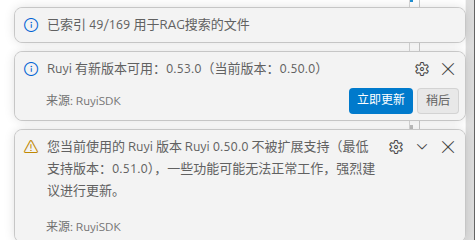

# 过低的如意版本时显示提示

## 操作步骤
安装最低支持版本0.51.0和不支持版本0.50.0及以下

## 预期结果
低版本ruyi会弹出低版本警告，文案为 您当前使用的 Ruyi 版本 0.50.0 不被扩展支持（最低支持版本：0.51.0）…；

## 测试结果
低版本ruyi会弹出低版本警告，文案为 您当前使用的 Ruyi 版本 0.50.0 不被扩展支持（最低支持版本：0.51.0）…；但是重复Ruyi前缀

